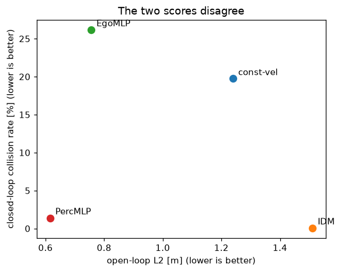

# REPORT — Lab Day 12: Phát lại và kiểm thử vòng kín

| Thông tin | Giá trị |
|---|---|
| Họ và tên | Hà Mạnh Tuân |
| MSSV (đúng bằng `--student-id` đã chạy) | `2A202602982` |
| GitHub | [tuanfptu](https://github.com/tuanfptu) |
| Repository nộp bài | [K4-Track4-DAY12-HaManhTuan-2A202602982](https://github.com/tuanfptu/K4-Track4-DAY12-HaManhTuan-2A202602982) |
| Seed chia dữ liệu / seed mô hình | 301 / 2630, 2631, 2632, 2633, 2634 |
| Số seed huấn luyện (`--seeds`) | 5 |

## Kết quả cuối

**Quyết định:** chặn constant-velocity, EgoMLP và PercMLP; PercMLP+ qua cổng của lab. Chưa đủ bằng chứng để thay IDM trong hệ thống thực tế.
Các khoảng dưới đây là min–max qua toàn bộ seed, không phải khoảng tin cậy; hai bộ điều khiển cố định chỉ có một kết quả.
L2 là trung bình sai số vị trí tuyệt đối tại các mốc dự báo của đề; tỷ lệ va chạm tính trên cùng 2,883 quỹ đạo kiểm tra.

| Bộ điều khiển | L2 vòng hở (m), dải seed | Va chạm vòng kín trên log (%), dải seed | Quyết định cổng |
|---|---|---|---|
| const-vel | 1.239 | 19.736 | BLOCK |
| IDM | 1.511 | 0.069 | baseline |
| EgoMLP | 0.752–0.760 | 22.477–32.258 | BLOCK |
| PercMLP | 0.613–0.620 | 0.694–3.052 | BLOCK |
| PercMLP+ | 0.807–0.831 | 0.208–0.277 | RELEASE (trong lab) |

Nguồn: [openloop.json](evidence/openloop.json), [closedloop.json](evidence/closedloop.json), [gate.json](evidence/gate.json).
Dải L2 của PercMLP+ được tính trực tiếp từ các model đã lưu trong [diagnostics.json](evidence/diagnostics.json); file này cũng lưu mã tái tạo, môi trường và dấu kiểm dữ liệu.

## Câu 1 · Dữ liệu

Ba rủi ro chính tôi kiểm tra là gia tốc xe dẫn sai lệch, quỹ đạo trùng và rò rỉ khi chia các khung hình lân cận.
`Acc_LV` tương quan với đạo hàm tốc độ chỉ 0.04535, trong khi cột gia tốc xe theo sau đạt 0.92909; vì vậy tôi khai thác phanh bằng đạo hàm của `Speed_LV` đã làm mượt.
Bộ dữ liệu có 992,679 dòng, 9,993 quỹ đạo; loại 383 bản trùng còn 9,610. Loại trùng trước khi chia ngăn cùng một chuyển động xuất hiện ở cả train và test qua ID khác nhau.
Tôi chia theo quỹ đạo: 6,727 train và 2,883 test, dùng seed 301; chia theo frame sẽ cho mô hình thấy các trạng thái gần như bản sao của mẫu kiểm tra.
Kiểm tra hình học cho thấy `Pos_LV - Pos_FAV - Spatial_Gap` bằng 4.5 m, sai lệch lớn nhất 3.64e-11 m; cần trừ chiều dài xe khi dùng vị trí để tính khoảng cách cản xe.
Nguồn: [data_audit.json](evidence/data_audit.json), [diagnostics.json](evidence/diagnostics.json); làm sạch giúp đánh giá nhất quán nhưng không tự bảo đảm đủ tình huống nguy hiểm.

## Câu 2 · Phát lại

Chạy lại cùng mã có 0/600 đoạn khác; refactor float32 làm 600/600 đoạn không bằng chính xác nhưng 0 đoạn vượt dung sai, sai số tuyệt đối lớn nhất 0.000403 m/s².
Sai số làm tròn và thứ tự phép tính giải thích khác biệt này; tôi so từng lệnh với `atol + rtol * |golden|`, cả hai hệ số 0.001, và coi hai NaN đệm cùng vị trí là bằng nhau.
AEB làm lệch 11/600 đoạn. Tôi mở đoạn 59: 4 khung bị lệch; ở khung 98, gap 4.3033 m, tốc độ tiến gần 2.9189 m/s, TTC 1.474 s, lệnh đổi từ -5.436 thành -6.0 m/s².
Các khung lệch là 98, 99, 100, 101: xe đang tiến gần và TTC dưới ngưỡng 1.5 s; lệnh chỉ đổi khi IDM chưa phanh mạnh bằng AEB. Vì vậy TTC thấp chưa đủ để mọi khung đều khác nếu IDM vốn đã phanh mạnh hơn.
Phát nhanh nhất có 0 khung trễ và 0 khung rớt; phát theo thời gian thật mô phỏng có 583 trễ, 576 rớt trên 59,840 khung và làm 384 đoạn vượt dung sai vì phải giữ lệnh cũ.
Nguồn: [replay.json](evidence/replay.json), [diagnostics.json](evidence/diagnostics.json); đây là mô hình chi phí xử lý để lộ lỗi deadline, chưa phải đo thời gian chạy trên phần cứng xe.

## Câu 3 · Kịch bản

Lưới chạy ở 12.0 m/s, gap 2.760–59.312 m, tốc độ tiến gần 0.0–12.0 m/s, tổng 2,700 ô.
Biên bất khả thi là `gap < dv*t_react + dv²/(2*b_max)` khi `dv > 0`: xe mất khoảng cách trong lúc chờ phản ứng rồi mới triệt tiêu tốc độ tương đối bằng phanh tối đa.
Trễ phản ứng chuyển từ 0 sang 0,6 s làm vùng bất khả thi và vùng đâm IDM tăng từ 2.222% lên 7.444%, tức 5.222 điểm phần trăm. IDM có diện tích đâm còn tránh được bằng 0.000% ở độ trễ lớn.
FullBrake khớp biên vật lý: 0 và 0 ô lệch ở hai độ trễ, sau khi bỏ dải sát biên do bước thời gian rời rạc; không nên quy mọi va chạm ở vùng bất khả thi thành lỗi thuật toán.
Khai thác được 614 ca phanh (6.389% quỹ đạo); mức phanh người lái ở phân vị dùng trong đề là 3.625 m/s², trong khi 8.556% lưới đòi hỏi phanh mạnh hơn. Đây là phân vị cực trị, không phải cực đại tuyệt đối của mọi mẫu.
Các chấm log trong hình tập trung ở tốc độ tiến gần thấp, bỏ thưa vùng gap ngắn và tiến gần nhanh; vì thế điểm tốt trên log không chứng minh khả năng xử lý cắt vào khó. Nguồn: [scenarios.json](evidence/scenarios.json).


## Câu 4 · Vòng hở và vòng kín

| Bộ điều khiển | L2 trung bình (m) | Hạng L2 | Va chạm trung bình qua seed (%) | Hạng vòng kín |
|---|---|---|---|---|
| const-vel | 1.239 | 3 | 19.736 | 3 |
| IDM | 1.511 | 4 | 0.069 | 1 |
| EgoMLP | 0.756 | 2 | 26.174 | 4 |
| PercMLP | 0.615 | 1 | 1.394 | 2 |

Bảng giữ đúng cách xếp hạng trong [closedloop.json](evidence/closedloop.json); dải seed của các mô hình học nằm ở bảng kết quả cuối.
Các cặp đảo thứ tự là constant-velocity–IDM, constant-velocity–EgoMLP, IDM–EgoMLP và IDM–PercMLP; điều đó bác bỏ việc dùng thứ hạng L2 để quyết định phát hành.
IDM có L2 1.511 m vì chọn khoảng cách và phản ứng theo luật riêng, không tái tạo chính xác cách người lái tăng giảm tốc; nó vẫn chỉ va chạm 2/2883 quỹ đạo vì sử dụng gap và tốc độ tương đối để phản hồi.
EgoMLP có L2 0.756 m, tốt hơn constant-velocity 1.239 m, nhưng chỉ nhìn lịch sử tốc độ bản thân nên không phân biệt được xe dẫn đang phanh hay khoảng cách đang co lại ở cùng một trạng thái ego.
Khi tự lái, sai số nhỏ đưa nó sang trạng thái chưa học rồi tích lũy qua phản hồi; tỷ lệ va chạm trung bình 26.174% thậm chí cao hơn constant-velocity 19.736%.
Lát cắt xe dẫn sắp phanh chỉ chiếm 4.381% cửa sổ; L2 PercMLP tăng từ 0.615 lên 0.882 m trên lát cắt, cho thấy trung bình che lỗi hiếm. Nguồn: [openloop.json](evidence/openloop.json).



## Câu 5 · Một lần chạy chưa đủ

EgoMLP dao động 22.477–32.258% qua 5 seed, rộng 9.781 điểm phần trăm trên cùng 2,883 quỹ đạo.
Seed tốt nhất 2630 có 648 va chạm, tỷ lệ 22.477%, Wilson 95% [20.990; 24.036]%; seed xấu nhất 2631 có 930 va chạm, 32.258%, Wilson [30.576; 33.987]%.
Hai khoảng này không chồng nhau: biến thiên huấn luyện đủ lớn để kết quả một lần chạy che mất rủi ro; chỉ chọn seed tốt sẽ báo 22.477% và bỏ qua khả năng 32.258%.
Wilson mô tả bất định của tỷ lệ trên tập quỹ đạo cho một mô hình cố định dưới giả định lấy mẫu phù hợp; dải seed mô tả bất ổn do huấn luyện. Không được dùng cái này thay cái kia hoặc xem các lần chạy trên cùng log là mẫu độc lập mới.
Tôi báo cả dải seed, khoảng Wilson và seed xấu nhất cho cổng; cận trên Wilson của IDM là 0.253%, cho thấy tỷ lệ quan sát nhỏ cũng không đồng nghĩa rủi ro bằng không.
Nguồn: [closedloop.json](evidence/closedloop.json), các trường `logs.EgoMLP.per_seed` và `logs.IDM.collision`; còn cần nhiều cách chia và dữ liệu độc lập để kiểm tra độ ổn định ngoài tập này.

## Câu 6 · Tác nhân phản ứng

Xe sau **phát lại**; mọi số dưới đây là phần trăm toàn lưới (any = va chạm phía trước hoặc phía sau):

| Bộ điều khiển | any, trễ ego 0 s | rear, 0 s | any, trễ ego 0,6 s | rear, 0,6 s |
|---|---|---|---|---|
| const-vel | 77.630 | 0.000 | 77.630 | 0.000 |
| IDM | 75.259 | 73.037 | 75.741 | 68.296 |
| EgoMLP | 77.963 | 0.000 | 77.889 | 0.000 |
| PercMLP | 80.296 | 69.889 | 77.852 | 51.741 |

Xe sau **phản ứng**:

| Bộ điều khiển | any, trễ ego 0 s | rear, 0 s | any, trễ ego 0,6 s | rear, 0,6 s |
|---|---|---|---|---|
| const-vel | 77.630 | 0.000 | 77.630 | 0.000 |
| IDM | 2.222 | 0.000 | 7.444 | 0.000 |
| EgoMLP | 77.963 | 0.000 | 77.889 | 0.000 |
| PercMLP | 17.259 | 0.000 | 27.185 | 0.000 |

Hiệu chỉnh trên train chọn `T = 1.4 s`, khoảng cách xe sau 18.8 m và trễ phản ứng xe sau 0.6 s; trung vị time headway của người lái là 1.857 s.
Khoảng cách phân bố W1 đạt 0.352 so với 0.865 của tác nhân không phản ứng: khớp hơn ở thống kê này, chưa có nghĩa giống hoàn toàn người thật.
Khi ego trễ 0,6 s, IDM bị xe sau phát lại đâm ở 68.296% ô vì xe sau cứ giữ tốc độ dù IDM vừa phanh; khi xe sau phản ứng, tỷ lệ đó bằng 0.000%. Đây là va chạm do giả định phản thực của playback, không đủ để kết luận IDM phanh sai.
IDM vẫn tốt hơn constant-velocity trong cả hai thế giới của lần chạy này, nhưng tổng va chạm giảm từ 75.741% xuống 7.444%; tôi không diễn giải thành đảo hạng khi số không cho thấy điều đó.
PercMLP thì đổi thứ tự với constant-velocity: phát lại là 77.852% so với 77.630%, còn phản ứng là 27.185% so với 77.630%. Loại bỏ hẳn xe sau cũng sẽ bỏ mất kiểm tra tương tác; cần mô hình hóa phản ứng và kiểm tra độ nhạy.
Nguồn: [agents.json](evidence/agents.json); với mô hình học, bảng lấy hàng do script chọn theo tổng va chạm lớn nhất trong thế giới phản ứng, rồi so hai thế giới của chính hàng đó, không ghép các cực trị từ seed khác nhau.

## Câu 7 · Cổng phát hành và sửa

PercMLP rớt R2 vì cận trên Wilson 3.745% vượt giới hạn 1.069%; rớt R3 vì cận trên lát cắt phanh 13.585% vượt 6.136%. Sai số bắt chước tích lũy khi tự lái là một giả thuyết nguyên nhân phù hợp các kết quả này.
R5 cũng rớt: dải va chạm 0.694–3.052%, rộng 2.359 điểm, cho thấy huấn luyện không ổn định. R4 rớt vì phần lưới còn tránh được nhưng đâm là 19.741% so với baseline 0.000%; R6 có 27.185% tổng va chạm so với IDM 7.444%. Hai mục sau bộc lộ lỗ hổng cắt vào ngoài phạm vi log.
Tôi thêm 20,000 kịch bản cắt vào với nhãn IDM, rồi 2 vòng DAgger chỉ trên log train: cho learner tự lái, ghi trạng thái nó đi vào và hỏi IDM dự báo từ đúng trạng thái đó. Dữ liệu tổng hợp phủ tình huống thiếu; DAgger dạy phục hồi khỏi trạng thái lệch do chính mô hình tạo ra. Không đổi ngưỡng hoặc dùng log test để huấn luyện.
Sau sửa, dải va chạm còn 0.208–0.277%, cận trên Wilson seed xấu nhất 0.547%; diện tích đâm còn tránh được ở trễ 0,6 s còn 0.185%. Cổng cho PercMLP+ RELEASE; bảng dưới ghi rõ quy tắc đổi trạng thái.
L2 trung bình đổi từ 0.615 thành 0.821 m: việc bám log kém hơn không quyết định an toàn. Các biên không kém hơn của lab cho phép sai khác và chưa chứng minh PercMLP+ tốt hơn IDM; mô hình học từ IDM cũng không có bằng chứng vượt thầy chỉ nhờ qua cổng.
Ở tốc độ chưa thấy 20.0 m/s, PercMLP+ vẫn đâm trong vùng tránh được 0.185–1.000% lưới, so với IDM 0.000–0.000%. Vì vậy tôi chỉ chấp nhận qua cổng lab, giữ IDM làm baseline và yêu cầu kiểm thử miền vận hành rộng hơn, tác nhân đa dạng, phần cứng trong vòng lặp và chạy shadow trước khi cân nhắc phát hành.
Nguồn: [gate.json](evidence/gate.json), [fix.json](evidence/fix.json), [closedloop.json](evidence/closedloop.json), [openloop.json](evidence/openloop.json). Đây là can thiệp kết hợp, chưa có thí nghiệm ablation để định lượng riêng đóng góp của dữ liệu tổng hợp và DAgger.

| Quy tắc | PercMLP | PercMLP+ |
|---|---|---|
| R1 | PASS | PASS |
| R2 | FAIL | PASS |
| R3 | FAIL | PASS |
| R4 | FAIL | PASS |
| R5 | FAIL | PASS |
| R6 | FAIL | PASS |
| R7 | PASS | PASS |

## Câu 8 · Bài lab này không chứng minh được gì

**Giới hạn hình học:** mô phỏng chỉ có chuyển động dọc và cắt vào được biểu diễn bằng thay đổi gap; không kiểm tra rẽ, đổi làn thực, người đi bộ hoặc tránh vật cản ngang. Vì vậy kết quả trên 2,700 ô không đại diện cho toàn bộ lái xe; cần tình huống đa tác nhân có hình học và quỹ đạo ngang.
**Giới hạn quan sát và phần cứng:** trạng thái log không thay thế cảm biến, che khuất, lỗi phát hiện hoặc mất thông điệp; replay mô phỏng đã có 583 khung trễ và 576 khung rớt. Cần đưa chuỗi perception, độ trễ thực đo và cơ cấu chấp hành vào vòng kiểm thử.
**Giới hạn tương tác:** xe dẫn vẫn phát lại, còn xe sau chỉ dùng IDM hiệu chỉnh `T = 1.4 s`; W1 0.352 không xác nhận mọi hành vi người lái. Cần tác nhân có nhiều kiểu phản ứng, kiểm tra độ nhạy tham số và đối chiếu tương tác bằng dữ liệu độc lập.
**Giới hạn phân bố:** log ngắn và một lần chia theo seed 301 không chứng minh tổng quát hóa; kiểm tra tốc độ 20.0 m/s vẫn cho PercMLP+ dải lỗi tránh được 0.185–1.000%. Cần mở rộng miền vận hành, thu tình huống hiếm và giữ tập kiểm thử mới sau khi phát hiện lỗi.
**Giới hạn thống kê và tiêu chí:** 5 seed cùng 2,883 log không chứng minh rủi ro cực hiếm; các log có thể còn phụ thuộc theo cảnh dù đã loại trùng. Cổng chỉ xét các chỉ tiêu được lập trình, chưa xét đủ tiện nghi, jerk, tiến độ hay xác suất gặp từng ô lưới ngoài đường.
Vì vậy RELEASE của lab là đạt bộ quy tắc hiện tại, không phải chứng nhận an toàn: cần xác lập miền vận hành, kiểm thử độc lập theo cảnh/địa điểm, mô phỏng đã kiểm chứng, thử nghiệm có giám sát và tiêu chí dừng trước quyết định triển khai.

## Tái lập và kiểm tra bài nộp

Chạy từ thư mục repo, sau khi cài Python và các thư viện của đề:

```bash
pip install -r requirements.txt
python run_all.py --student-id 2A202602982 --seeds 5
python -m unittest discover -s tests -v
python scripts/check_submission.py --save-verify
```

Lần nộp này chạy đầy đủ, không dùng `--quick`. Môi trường đo: Python 3.12.14, numpy 2.5.4, pandas 3.0.6, matplotlib 3.11.2; đặt `OPENBLAS_NUM_THREADS=1`, `OMP_NUM_THREADS=1`, `MKL_NUM_THREADS=1` trước khi chạy để hạn chế khác biệt do BLAS.
Trên Windows dùng UTF-8 cho Python và đặt cache matplotlib trong thư mục có quyền ghi nếu cần.
Dữ liệu tải về có 195,380,179 byte; SHA-256: `0739657faf49edc3c59198748d7741fb589d3a90b946490fd295c4a5acf2d82f`.
Chỉ thân các hàm TODO và báo cáo được sửa; bằng chứng được tạo bằng chương trình, giữ nguyên mã kiểm thử, bộ mô phỏng và ngưỡng cổng. Không đưa `data/` hoặc `work/` lên GitHub.

Để tái tạo bằng chứng bổ sung sau khi pipeline đã lưu model, trích script đo được nhúng trong `diagnostics.json` rồi chạy nó (thư mục `work/` được Git bỏ qua):

```bash
python -c "import json,pathlib; p=pathlib.Path('work/inspect_run.py'); p.parent.mkdir(exist_ok=True); p.write_text(json.loads(pathlib.Path('evidence/diagnostics.json').read_text(encoding='utf-8'))['generator_source'],encoding='utf-8')"
python work/inspect_run.py
```

`diagnostics.json` không sửa bất kỳ bằng chứng chuẩn nào: nó tính lại L2 từng seed PercMLP+ và đọc lệnh AEB ở đoạn bị lệch, đồng thời ghi phiên bản môi trường và dấu kiểm dữ liệu để giảng viên có thể đối chiếu.
